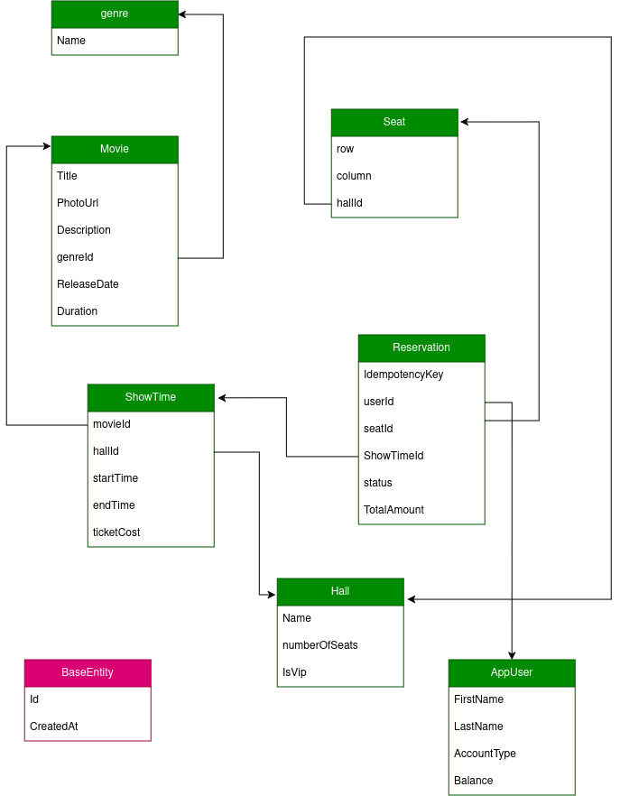

## 🎬 Movie Reservation System

A backend system for browsing movies, managing showtimes, and booking seat reservations, built with **.NET 9**.

### Tech Stack

- **Framework:** ASP.NET Core 9 (Web API)
- **Authentication & Authorization:** ASP.NET Core Identity
- **Database Access:** Entity Framework Core
- **API Documentation:** [Scalar](https://scalar.com/) — interactive API reference
- **Cloud Storage:** [Backblaze B2](https://www.backblaze.com/cloud-storage) (S3-compatible object storage) — used for storing movie posters/media

### Entity Relationship Diagram



### Features

- User registration & authentication via ASP.NET Core Identity
- Browse movies, showtimes, and theaters
- Reserve and manage seat bookings
- Role-based access (e.g., Admin vs. Customer)
- Auto-generated, interactive API documentation via Scalar
- Media storage (posters, banners) hosted on Backblaze B2

### Getting Started

#### Prerequisites

- [.NET 9 SDK](https://dotnet.microsoft.com/download)
- SQL Server (or your configured provider)
- A Backblaze B2 account with a bucket and application key

#### Setup

1. Clone the repository
```bash
   git clone https://github.com/OmarTamer2/MovieReservationSystem
   cd <project-folder>
```

2. Configure your connection string and Backblaze credentials in `appsettings.json` or user secrets:
```json
   {
     "ConnectionStrings": {
       "aspmonster": "your-connection-string"
     },
     "BackBlazeB2": {
       "KeyId": "your-key-id",
       "ApplicationKey": "your-application-key",
       "BucketName": "your-bucket-name"
     }
   }
```

3. Apply migrations
```bash
   dotnet ef database update
```

4. Run the project
```bash
   dotnet run
```

5. View API docs at `/scalar` (or your configured route)
